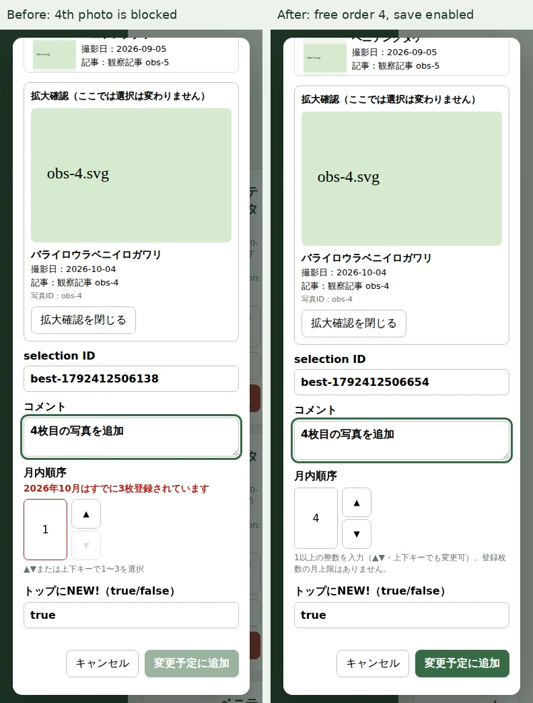
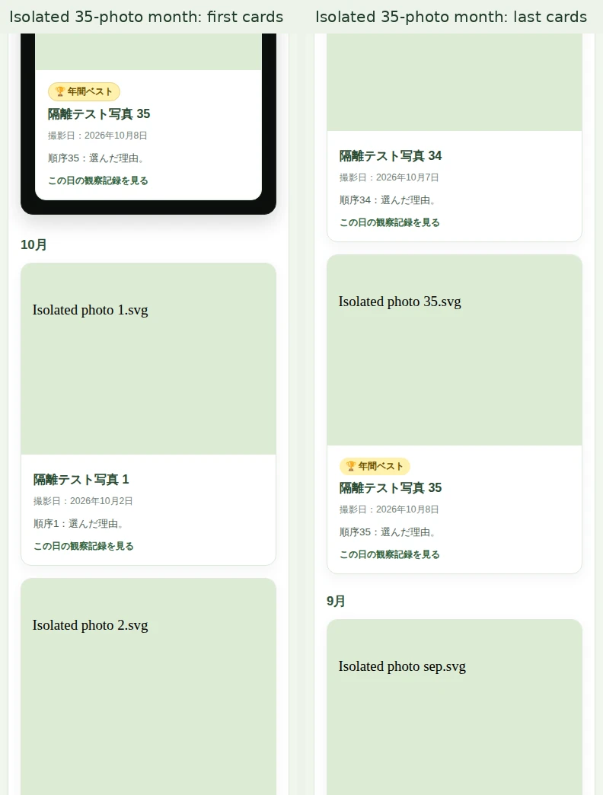

# Best Shot 月間上限撤廃 — Draft PR #127

月3枚という業務上の上限を撤廃しました。月4・10・30・35枚を追加・編集・保存でき、既存12件は移行・再採番しません。**マージ承認待ちです。マージ・本番再生成・Pages公開は行いません。**

## 基点と保護対象

- main: `c3a0420e01a24afe0b86b4eb6c6ee0999c93ad11`
- gh-pages: `060f09c6ab9374f9cb38e8c46b6c2f29f1a1ab29`
- 本番履歴ブランチ: `9d4e624559e67c90376562f94a0d9b764429609a`
- 実装の検証HEAD: `682d4efc48a50f3a6ffba301688725349dcfb78e`

開始時の確認中、別作業によりPR #123がマージされました。その最新mainを基点に専用ブランチ `feature/best-shot-unlimited-month-20261019` を作成しています。PR #123のブランチは変更していません。公開済み再生成は既存run [39248355027](https://github.com/charchan123/hatena-photo-gallery/actions/runs/39248355027)によるものです。この作業のActionsはPR検証専用です。

最新公開データは写真933枚、Best Shot12件、研究室66件、退役7枚、master141種、sources419件。直前の公開コミット `3a64e76f202f8d9833ba9ee324e0ba1042197cc6` と現公開の全observationレコードも一致しました。[protection.json](protection.json)に選択ID・写真ID・年間Bestと保護対象ファイルのSHA-256を保存しています。実データ・通知・退役・承認履歴は変更していません。

## 実装

- `best_shot_ui.py`: 月間件数とorderの上限3を撤廃。orderはboolを除く正の整数。月内順序重複の英語エラー `order must be unique within a year and month`、写真重複、ID重複、撮影日・コメント・年間Best検証を維持。
- `admin/static/admin.js`: 順序を直接入力可能にし、▲▼・上下キーも4以上に対応。新規写真選択・月変更では、その月の未使用の最小の正整数を採用。編集中の本人は除外し、他の選択の番号は変更しません。保存失敗後も入力と再試行を保持します。
- `admin/static/admin.css`: 編集可能なカーソルと、長いselection IDがスマートフォンの一覧幅を広げない折り返し・列幅修正のみ。
- `admin/core.py`・API実装は既存の共通validatorを利用するため変更不要。既存の月順・年順・年間Bestと公開カードrenderer、`assets/best-shots.css`は変更不要でした。
- PR専用のChromium workflowに隔離fixtureと比較画像の保存を追加。本番workflow、公開条件、日次同期、削除ゲートは変更していません。

## 検証結果

| 対象 | 結果 |
|---|---|
| Python全pytest | 990 passed（既存966件＋追加24件） |
| Python構文 | compileall PASS |
| JavaScript | 全11回帰ファイル・構文検査 PASS |
| 管理室Chromium | 295 assertions PASS、1280px/390px |
| 公開ページChromium | 2,513 assertions PASS、1280px/390px |
| 削除承認Chromium | 31 assertions PASS |
| 既存通知Chromium | 1,791 assertions PASS |
| 実API・隔離プレビュー | 認証付き完全取得12ページ・公開111記事・980画像、933→933、削除候補0 |

Chromiumは合計4,630項目。管理室は隔離API/画像fixtureを使用し、実HTTP Handlerへの追加・更新・削除はPython側でも検証します。本番の管理室へ試験データを書き込みません。

月1/3/4/10/30/35枚で、追加、自動順序、空き番号2の再利用、直接入力・ボタン・キーボード、編集、写真差し替え、別月への移動、削除、写真重複拒否、年間Best指定と削除時解除を確認。検索（かな・IME）、プレビュー、未知の撮影日、順序重複、非整数・空欄・負数、通信失敗・サーバー拒否・連打・再試行も検証しました。既存ID・コメント・任意フィールドと年間Bestの無変更編集も保持します。

公開ページは実generatorで同じ月別件数を生成し、年/月の降順、orderの昇順、年別アーカイブ、年間Best、長文コメント、縦横比の異なる画像、全カードの重なり・横はみ出し0を確認。既存12件については旧/新モデルと全公開Best Shot HTMLがバイト単位で一致し、写真リンク・選択IDも同一です。実公開写真のサムネイルはGETで取得し、ブラウザでは隔離キャッシュから表示します。

月4/10/30/35枚の最高順序の写真でも、通常選択・未マージPRの選択の双方について、独立2回・7時間間隔の欠落確認後に無承認削除が阻止される試験8件を追加しました。削除の独立確認・時間間隔・参照保護・承認処理は緩和していません。

実APIの要約は [live-api.json](live-api.json)、ブラウザの測定値は [browser-result.json](browser-result.json)、[admin-result.json](admin-result.json)、生成時の同一性検証は [fixture-summary.json](fixture-summary.json) を参照してください。

3系統の検証HEADは上記`682d4efc…`で一致します。

- [Validate Admin Changes — SUCCESS](https://github.com/charchan123/hatena-photo-gallery/actions/runs/39251373272)
- [Deletion review browser regressions — SUCCESS](https://github.com/charchan123/hatena-photo-gallery/actions/runs/39251373289)
- [Read-only deletion audit — SUCCESS](https://github.com/charchan123/hatena-photo-gallery/actions/runs/39251373180)

[VALIDATION.json](VALIDATION.json)に集計・artifactのSHA-256を保存。公開ページ比較画像は同一renderer/CSSの先行run 39250582399で取得し、最終実装のrun 39251373289でも同じ2,513項目を再検証しました。管理室の比較画像は最終実装runから取得しています。この証跡保存コミット後の最終HEADのCIはPRのChecksも確認してください。

## 比較画像

左が変更前、右が変更後。管理室は同じ月に3枚が登録された状態で4枚目を選択しています。旧実装は保存不可、新実装は順序4を自動設定し保存可能です。比較は本番mainのJS/CSSと変更後のJS/CSSを使用します。

| 画面 | PC 1280px | スマートフォン390px |
|---|---|---|
| 管理室：4枚目追加 | [Before / After](admin-1280-before-after.webp) | [Before / After](admin-390-before-after.webp) |
| 公開ページ：既存12件 | [Before / After](public-1280-before-after.webp) | [Before / After](public-390-before-after.webp) |
| 公開ページ：隔離した月35枚 | [先頭 / 末尾](public-1280-month-35.webp) | [先頭 / 末尾](public-390-month-35.webp) |

## 発見した問題と対応

拡張したChromium試験で、スマートフォンの長いselection IDが一覧を横へ広げ、編集ダイアログの保存ボタンのクリック判定がずれる問題を検出しました。一覧の写真/本文列を`minmax(0,1fr)`へ変更し、メタデータを折り返すことで解消。強制クリック等による回避は使用せず、一覧の横はみ出し0とダイアログ内の実クリックを再検証しています。

初回のローカル全試験では既存同期fixtureのsetupで`OUTPUT_INTEGRITY_ERROR`が33件出たため調査しました。該当単体と無修正の全再実行で再現せず（982件合格）、保護試験追加後は全990件合格。GitHubの隔離生成後の全試験も確認しています。安全ゲート・fixtureの判定を緩和する変更は行っていません。

## 残存リスクと導入判断

既知の機能上の未解決事項はありません。月間登録枚数に業務上の上限はありません。ブラウザで実測した件数は月35枚までで、極端に大量の登録は既存の全件描画方式に従って表示負荷が増えます。順序入力はJavaScriptが正確に扱える整数範囲で検証し、精度を失う値は保存前に拒否します。

レビュー時は本PRの最終HEADの3系統がすべてSUCCESSであることと比較画像を確認してください。承認後の導入でも既存12件を再登録・再採番する必要はありません。この作業では実際のBest Shot追加・削除や年間Best変更をしていません。Draftを維持し、明示的なマージ承認を待ちます。
