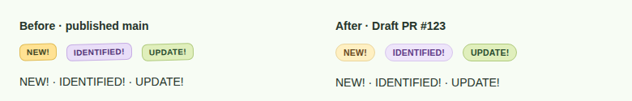
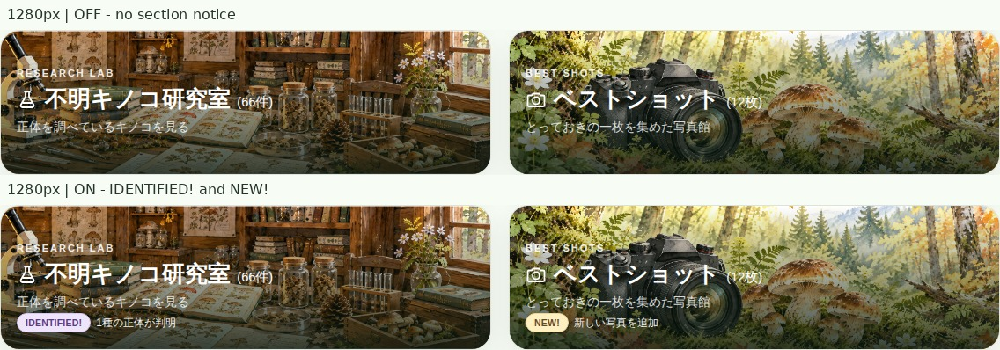
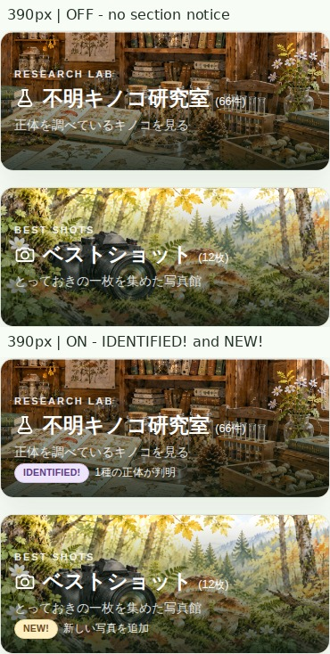
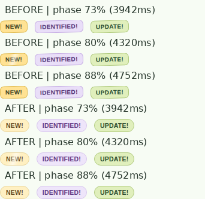

# PR #123 — 通知レイアウトと丸型バッジのマージ前監査

本番公開は行っていません。既存PR #123をDraftで維持し、見た目の確認とマージ承認を待ちます。

## 作業基点と統合

- main: `edb77003fb6f648979a10df9efe1e8e010a15e9f`
- gh-pages: `225064d4ecea3a87dd1e25a5cd9b9a87d299919a`
- PR #123元HEAD: `789994cffcf04cc9d8ba52ef1ba4b2df45a0499b`
- 統合コミット: `307e86c647a517974ffa8e750ebc98218997abb3`。元HEADと最新mainを親とする通常のmergeで、競合なし。既存実装・監査記録を保持し、force pushなし。
- 検証した実装HEAD: `379bbfd8bdab7b54aae53d83a3cb3da80cfcb1ad`。本レポートと画像を保存する後続コミットでは実装を変更しません。
- PR #124/#125の公開済み変更、PR #126の保護付きCIを取り込み済み。main・gh-pages・本番履歴ブランチへの書き込み、PRのReady化・マージは行っていません。

## 実装

既存PRの46px説明領域と`.portal-guide-note__details`を再利用しました。説明と通知を別の行として常に確保し、通知の有無で説明の中央寄せ位置が変わることを防止します。長い通知は1行で省略し、全文はDOMに保持します。検証で判明したカード内グリッドの内在幅によるはみ出しも、`min-width:0`と`minmax(0,1fr)`で制約しました。

カードのmin-height、タイトルのフォント設定、背景画像、明暗・彩度、リンク先は変更していません。46pxの領域確保は旧PRの38pxからの変更を引き継いでおり、従来mainと全ピクセル同一のレイアウトを主張するものではありません。今回の受入基準は、同一画面幅で通知ON/OFFによる文字移動がないことです。

バッジは水平のピル型、22px高、10.5px/700、2px 9pxの余白、999pxの角丸としました。NEW!は`#fff0c2` / `#68491e`、IDENTIFIED!は`#eee5fa` / `#603b87`です。UPDATE!の緑系配色・機能は維持し、共通の形状のみ揃えました。観察記録の既存NEW!にも同じCSSを使用します。

## 位置測定と実ページ比較

実際の`generate_new_top`が生成したHTML、現在の公開933枚から作成した観察記録、リポジトリ内の本物の背景画像を使用しました。記事の外部サムネイル通信は隔離ブラウザで遮断し、今回の背景画像・文字・通知の検証には外部画像の成否を持ち込みません。通知だけを一時ディレクトリに生成し、本番の通知JSONには書き込みません。

有効な通知形式（研究室だけIDENTIFIED!、最大80文字）を用い、通知なし・NEW!・研究室IDENTIFIED!・長文・両カード・研究室のみ・Best Shotのみの7状態を比較しました。Guide/Season/Featuresにも通知あり・なし・長文の条件を適用しました。各状態の可視通知件数も検査し、非表示のまま比較が通ることを防いでいます。

| 画面幅 | タイトル最大Y差 | 説明文最大Y差 | カード高さON/OFF差 | 比較 |
|---|---:|---:|---:|---|
| PC 1280px | 0px | 0px | 0px | [2カード](1280-cards.jpg) / [Guide等](1280-guide.jpg) |
| タブレット768px | 0px | 0px | 0px | [2カード](768-cards.jpg) / [Guide等](768-guide.jpg) |
| スマートフォン390px | 0px | 0px | 0px | [2カード](390-cards.jpg) / [Guide等](390-guide.jpg) |

全5区分×3画面幅×7状態で比較しました。詳細座標は[browser-result.json](browser-result.json)に保存しています。通知期限後にpageshowで非表示になった場合も位置が維持されます。実測の研究室/Best Shotカード高さはPC165px、タブレット162px、スマホ157pxで、同一幅では全状態同一です。

[観察記録の既存NEW!と元の日付表示](records-new.jpg)。配置・日付生成処理・記事情報は変更していません。

## キラーンの保護

最新mainの`/* A quiet, periodic sweep: */`以降を現在のCSSとバイト単位で比較し、一致を検証しました。疑似要素、キーフレーム、透明度、白色のalpha、幅38%、移動方向、skew -19deg、移動480%、全表示場所の遅延、reduced-motion処理を含みます。

- 保護ブロックSHA-256: `6346de63c0f6606d6d2d6c318d9e4372733dc58d5bbc96c84d99db5255cb9115`
- 周期5.4秒、linear、infiniteを保持。観察記録2行目-1.8秒、3行目-3.6秒、Best Shot -2.7秒の遅延を保持。
- 同じChromiumでCSSアニメーションを0/3942/3996/4320/4752/4860/5400msに一時停止し、旧/新のopacity・背景・タイミングと、疑似要素幅に対する移動比率が一致することを検証。
- 実アニメーションの計算済みスタイルを測定しており、別の演出で置き換えていません。バッジ幅のデザイン変更に伴う絶対pxの幅・移動距離は変わりますが、元の38%/480%と時間定義は同一です。
- `overflow:hidden`で新しい丸いバッジ内を光が横切ることを実ブラウザで確認。reduced-motionでは以前と同じくアニメーションなし・疑似要素非表示。

NEW!7日・IDENTIFIED!14日、開始/終了時刻、リンク、期限更新、通知履歴の処理は変更していません。既存Python・JSの期限/復帰テストも再実行しています。

## 検証とデータ保護

- Python全966件PASS、構文検査PASS。UI変更後に全テストを再実行しました。
- JavaScript構文検査、全11回帰スクリプトPASS。
- Chromium追加669項目PASS。既存Best Shot 92項目、削除承認31項目もPASS（合計792項目）。PC/タブレット/スマホ、長文省略、バッジ高・水平表示、期限更新、各位相、reduced-motionを含みます。
- 最新Hatena API読み取り専用監査：933→933、欠落0、名前変更0、URL変更0、削除候補0、保護対象削除候補0。保護付き生成はPREVIEWで停止し、公開出力も履歴書き込みもありません。
- 公開データ：933個の一意な写真ID・URL、Best Shot12参照すべて1回だけ解決、研究室66件、退役7枚のID/URL不在、削除済み2025/09/02記事不在を確認。[protection.json](protection.json)
- `data/`、`sync-migrations/`、同期/削除実装、本番生成ワークフロー、保護付きadmin検証経路、写真登録・分類・削除、master/sources/facets、研究履歴、承認/Git履歴はmainとの差分なし。
- 本番通知JSON SHA-256: `33e70703b4d84fac5764dc3b201a61e64cf09547374391f543e9c638414146e4`。架空イベントの混入なし。

実装HEADのActions（監査証跡保存後の最終HEADも同じ3系統を再確認し、PR説明にリンクします）:

- [Validate Admin Changes](https://github.com/charchan123/hatena-photo-gallery/actions/runs/39136762776)
- [Deletion review browser regressions](https://github.com/charchan123/hatena-photo-gallery/actions/runs/39136762635)
- [Read-only deletion audit](https://github.com/charchan123/hatena-photo-gallery/actions/runs/39136762691)

比較元のChromium artifact SHA-256: `732764a292f59b1b061bc8ecad7cd105ab45615d32f412c9c3696c2224e2c2d9`。ZIPの整合性を検証して取得しました。比較画像はこの監査フォルダへ永続保存し、同一CSSでの最終コード実行の元スクリーンショットともバイト一致を確認しました。

## 判断と残る確認

通知ON/OFFの位置ずれ、長文時の省略失敗、キラーンの変更、本番データ変更という未解決問題はありません。実装・検証上はマージ可能と判断しますが、最終HEADの3系統CI成功と、ユーザーによる比較画像の見た目承認を条件とします。実ブラウザ検証はChromiumで行っており、他ブラウザ/OSのフォント描画差までは保証しません。

PR #123はDraftのまま停止します。マージは日次の自動再生成・公開につながり得るため、ユーザーの新たな明示承認後にのみ行ってください。
