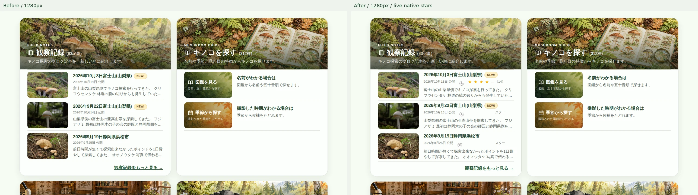
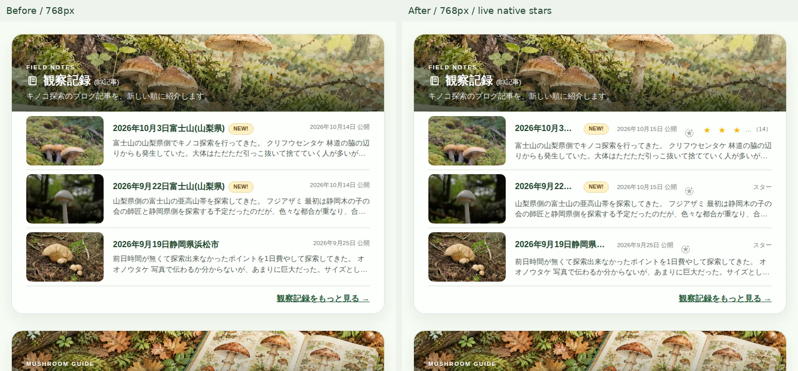
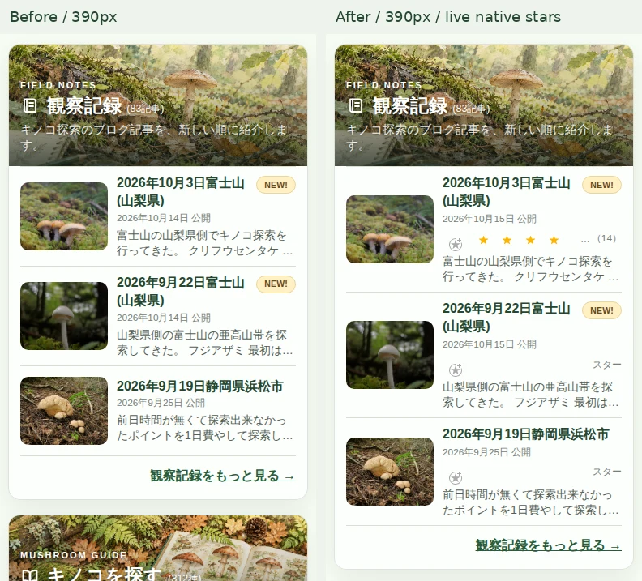
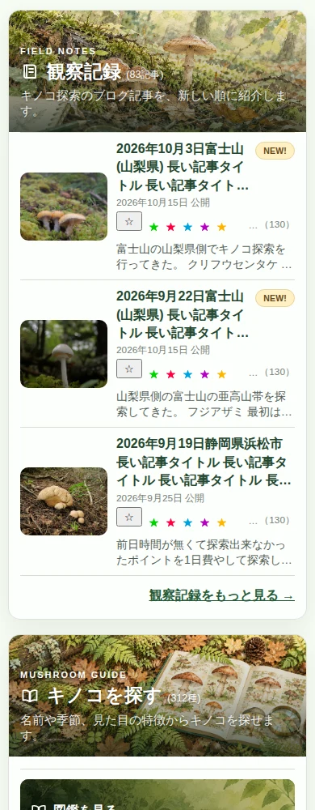
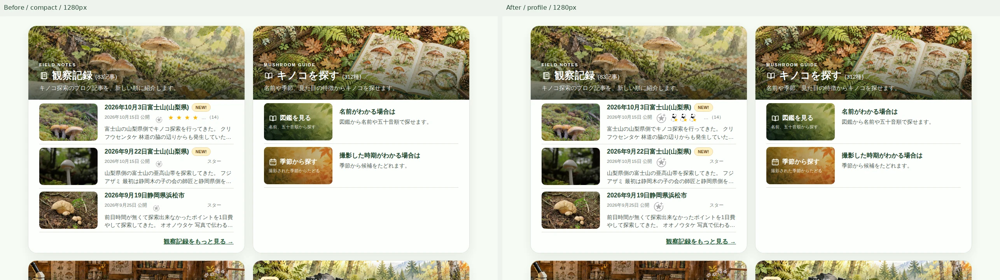
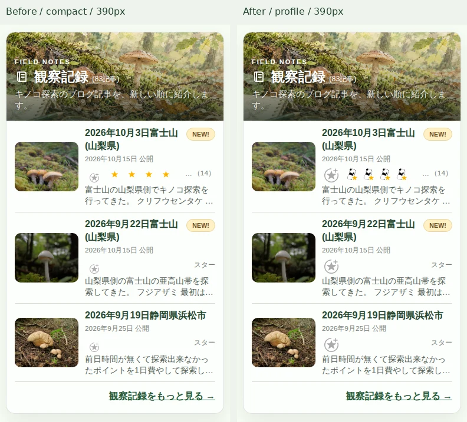
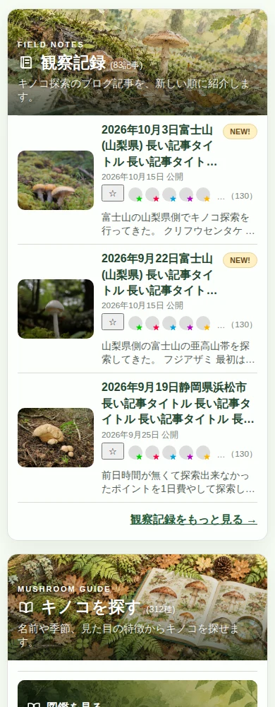

# 観察記録3記事のはてなスター — PR #128

**最新：2026-10-20 JSTの投稿者アイコン対応は本書末尾の追補を参照してください。以下の初回検証記録も保持しています。**

2026-10-19 UTC。Draft・レビュー待ち。マージ、公開、実スターの追加・削除は行っていません。

## 結果

公式 HatenaStar.js の SiteConfig に各元記事の HTTPS permalink を指定し、公式の追加ボタン・スター画像をそのまま表示します。GitHub Pages の URL をスターの登録先にしません。最新3記事だけが対象です。

実記事の公開 API と公式ウィジェットは、順に **14 / 0 / 0** で一致しました。今回の実記事にカラースターはありません。黄色・緑・赤・青・紫の混在、同一ユーザーの複数スター、圧縮カウント、130個は隔離した応答で検証しています。実データが増減すれば次回表示時に読み直し、現在の公式 DOM の更新にも追随します。定期ポーリングは行いません。

**ログイン済みの読者が本番で実際に追加できることは未確認です。** 本番の追加ボタンは存在と紐付けだけを確認し、押していません。マウス・キーボード・タッチでの追加と件数更新は、通信先を隔離した模擬ボタンでのみ確認しました。認証 Cookie、ブラウザの追跡防止、将来の埋め込み設定により直接追加できない場合は、元記事への「スター」または件数リンクから操作できます。公開前に実追加まで確認する場合は別途明示承認が必要です。

## 開始・終了時の本番状態

| 参照 | SHA |
| --- | --- |
| main | `4c6b978aebe3ab3e580025b36f74a158c08acb11` |
| gh-pages | `9b31736fa18c5e8e69769ca1e675f596001f6bae` |
| 実装検証 head | `824a33ba4db6c8f90ed6839d1a63176c9c71a97a` |

前タスクの PR #127 は開始前にマージ済みです。本機能はその最新 main から専用ブランチ `feature/record-hatena-stars-20261019` を作りました。他の未マージ PR #121/#116/#112/#111/#2 は変更していません。

公開中の Pages `new-top.html` は 200 です。現在のブログホームは通常の記事一覧で、new-top の iframe 埋め込みは見つかりませんでした。公開済みのトップに本機能が導入された、または実ブログでの追加操作が検証済み、という意味ではありません。

## 公式仕様と実現方法

- [HatenaStar.js / SiteConfig](https://developer.hatena.ne.jp/ja/documents/star/misc/hatenastarjs/): `entryNodes` の `uri` を元記事リンク、`title` を見出し、`container` を専用領域へ指定。
- [公開 Entry API](https://developer.hatena.ne.jp/ja/documents/star/apis/entry/): 公開 GET による独立照合。`stars` と全 `colored_stars`、省略時1となる `count` を集計。同じ名前でも重複排除しません。
- [画像 API](https://developer.hatena.ne.jp/ja/documents/star/apis/image/): 公式の画像・色を維持する方針の確認に使用。

公開 entry.json の今回の応答には Access-Control-Allow-Origin がありません。製品から独自のクロスオリジン fetch を実装せず、公式スクリプトに取得・認証・追加を委ねました。独自投稿 API、非公開 API の直接呼び出し、認証情報の埋め込みはありません。公式ライブラリ内部の iframe 通信は観測のみです。

参考 ss107.png の利用者アイコンを並べたブログ専用表示と、汎用の公式 HatenaStar.js が提供する小型スター画像の見た目には違いがあります。単なるテキストの黄色い星への置換はしていません。元記事の同じスターを表示しています。

今回の公式ウィジェットは open Shadow DOM を使用します。ネイティブ追加 iframe・イベントハンドラ・色別画像 URL を保持し、表示しきれない兄弟要素だけを隠します。総数は隠した要素も含め、公式の圧縮数値も合算します。予期しない構造や安全な整数でない数値は推測せず、元記事リンクに戻します。

空の公式 DOM は0件と取得待ち・通信失敗を区別できません。そのため **未確定時は「（0）」を出しません**。表示可能な公式ボタンと「スター」リンクを残します。正の件数は確定後に `…（14）` のように表示します。全アイコンが収まる場合は省略記号を出しません。

公式スクリプトは DOMContentLoaded に依存するため defer で初期化します。ローカルアダプターが欠落しても空の SiteConfig で別 URL の自動登録を防ぎます。第三者スクリプトが遅延しても、既存のフェードインによってページが透明なままにならないよう、3秒後に生成済み HTML を表示します。通知スクリプトは公式スクリプトより先に読み込みます。

## 元記事との照合

| 記事 | permalink | 公式API / ウィジェット |
| --- | --- | --- |
| 2026年10月3日富士山(山梨県) | [2026/10/15/064155](https://exsudoporus-ruber.hatenablog.jp/entry/2026/10/15/064155) | 黄14 / 黄14 |
| 2026年9月22日富士山(山梨県) | [2026/10/15/063503](https://exsudoporus-ruber.hatenablog.jp/entry/2026/10/15/063503) | 0 / アイコンなし |
| 2026年9月19日静岡県浜松市 | [2026/09/25/225327](https://exsudoporus-ruber.hatenablog.jp/entry/2026/09/25/225327) | 0 / アイコンなし |

元記事 HTML の canonical と公式スター領域も確認しました。件数は観測時点の値で、固定値を製品に書いていません。[fixture.json](fixture.json) に公開URL・実データ・応答確認を保存しています。

## HTML・表示変更

`records_ui.py` の行全体の a 要素を article に変更し、写真・タイトル・抜粋のリンクとスター領域を兄弟に分離しました。入れ子の a 要素はありません。元記事リンクは `_top` と `noopener noreferrer` を維持します。スター追加は記事リンクの内側に入りません。読み上げ用の領域名・ボタン iframe 名とフォーカス表示を付けています。

公開日の既存 UTC 日付切り替わりにより、日本時間10月15日公開が10月14日になるケースも確認しました。今回の3記事プレビューだけを JST で整形し、他の観察記録ページの既定書式と保存データは変更していません。Before/After の日付差はこの修正です。

幅に応じて、日付 → 公式追加ボタン → 正確な総数 → 収まるアイコンの順に領域を確保し、狭いときはスターを次行へ送ります。公式追加領域は36×28px以上、粗いポインターのスターリンクは28×28px以上を確保しています。

| 幅 | 非同期表示前後の日付 Y 差（3記事） | はみ出し |
| --- | --- | --- |
| 1280px | 0 / 0 / 0px | なし |
| 768px | 0 / 0 / 0px | なし |
| 390px | 0 / 0 / 0px | なし |
| 320px | 0 / 0 / 0px | なし |

1024px/640px の有効 CSS 幅も確認しました（1280pxで125%/200%相当。実ブラウザのズームメニュー操作そのものではありません）。

## 比較画像

同じ生成済み実データから、左 Before / 右 After。1280/768 は先頭680px、390/320 は先頭675pxを比較しています。元の全画面スクリーンショットは Actions artifact にも保存しています。

130個・カラースター・長いタイトルの隔離ケース（本番イベントや本番スターは作成していません）：

## 検証

実装 head 824a33b の4系統はすべて SUCCESS です。

| 検証 | 結果 | Actions |
| --- | --- | --- |
| Python全件・構文 / JavaScript構文・回帰 | 1002 passed / 12ファイル合格 | [Validate Admin Changes](https://github.com/charchan123/hatena-photo-gallery/actions/runs/39261445958) |
| 既存Chromium回帰 | 4630 assertions（295+31+1791+2513） | [Deletion review browser regressions](https://github.com/charchan123/hatena-photo-gallery/actions/runs/39261445859) |
| 認証付き完全API取得・隔離生成 | PASS、333 HTML | [Read-only deletion audit](https://github.com/charchan123/hatena-photo-gallery/actions/runs/39261445769) |
| 本スター機能Chromium | 402 assertions | [Read-only Hatena Star preview](https://github.com/charchan123/hatena-photo-gallery/actions/runs/39261445917) |

スター専用試験は実際の公式 JS・iframe を使い、元記事URI、実APIとの総数・色別一致、4幅、非同期座標、原画像、公開 Pages と同じオリジンの隔離プレビューを確認しています。第三者 Cookie 制限を有効にした読み取りと、はてな側の隔離親ページからの別オリジン iframe 表示も通りました。これはブラウザ内だけの応答差し替えで、Pagesやブログにはアップロードしていません。

模擬応答では0件・5件・130件・色混在・圧縮数値・未ログイン相当・未知構造・通信失敗・遅延・アダプター欠落を確認。写真・タイトルの移動、隔離ボタンのクリック/Space/タップ、単発更新、NEW!との共存も検証しました。公開記事の実追加操作は未実施、認証後の実動作は未確認です。

試験通信は GET のみ許可し、追加・削除に該当するエンドポイントも遮断しています。[browser-result.json](browser-result.json) の writes/errors は空です。比較APIは公開GETのみ、別系統の全記事監査は既存の認証付き読み取り専用経路です。

最初のローカル全件実行では既存の同期フィクスチャ初期化に関連する OUTPUT_INTEGRITY_ERROR が出ました。同じコードの再実行は1002件合格し、クリーンな Actions 実行も1002件合格です。安全ゲートは緩和していません。

## 本番データ保護

最新の認証付き監査（2026-10-19 13:35 UTC）は12ページ・112エントリーを完全取得し、下書き1件を除いた111記事・980画像を確認しました。[api-audit.json](api-audit.json) に要約を保存しています。

- 公開933枚 → 隔離候補933枚。既存ID933保持。欠落・追加・改名分類差分・URL変更・削除候補すべて0。
- Best Shot参照12、研究室66を保持。退役7枚すべて出力不在、復活0。
- master141種 / sources419件、feature facets、通知イベント、Best Shot選択、研究履歴、退役manifestは変更なし。
- 写真登録・分類・削除処理、Git履歴・承認処理、日次同期、本番公開workflowは変更なし。[protection.json](protection.json) に21ファイルの一致ハッシュを保存。
- 監査は `history_persisted=false`、`publication=NOT_ATTEMPTED`。履歴ブランチに試験データは書いていません。

## 変更ファイル

- 製品：`records_ui.py`、`main.py`、`assets/record-stars.css`、`assets/record-stars.js`。
- 検証：`tests/test_records_ui.py`、`tests/test_top_portal.py`、`tests/test_update_notices.py`、`tests/test_record_stars.js`、`tests/browser/record_stars_fixture.py`、`tests/browser/record_stars.cjs`。
- 独立した読み取り専用CI：`.github/workflows/record-stars.yml`。
- 証跡：本フォルダー、HANDOFFへの追記。

## 判断と残る条件

表示機能と元記事との対応付けはレビュー可能です。Draftを維持し、マージ・公開は承認待ちとします。直接追加は公式ボタンを設置していますが、認証済み本番操作を保証できる段階ではありません。実運用ではブラウザの認証制限が残り、元記事リンクを代替として常に提供します。

公式ウィジェットの DOM は上流変更の影響を受けます。今回の未知構造では件数推測をせずリンクへ退避し、専用CIを継続できます。スター数は閲覧時点のスナップショットで、他の閲覧者による更新は再表示時に反映されます。公開先での最終認証確認と、マージ・公開判断はユーザーに委ねます。

---

## 2026-10-20 JST 追補：元ブログと同じ投稿者アイコン表示

**この追補が最新です。上記の12件・小型スター表示は前回検証の保存記録です。** 今回は既存Draft PR #128を更新し、最新mainを取り込みました。マージ・公開・実スターの追加/削除は行っていません。

### 参考画像との違いと解消

今回の `ss107.png` は添付ファイルの取り込みが失敗しました。メッセージ内に表示された参考画像を目視し、元ブログの公開HTML・公式JavaScript・実ブラウザ表示を独立に照合しました。元画像ファイルを読み込んだ、保存した、という扱いにはしていません。

| 要素 | 前回PR #128 | 今回 |
| --- | --- | --- |
| 投稿者 | ホバー時のID表示のみ、小型スター | 元ブログと同じ丸い投稿者画像と右下のスター |
| スターの形・色 | 公式の11×10pxスター単体 | 公式の20px投稿者画像＋9×8px色別スター |
| 並び・間隔 | 小型スター用 | 公式profile-iconの順序・24px幅を保持。タッチ時は28px以上の領域 |
| 追加ボタン | compact版 | 元ブログと同じprofile-icon版（灰色の星と＋） |
| ホバー・移動先 | 汎用プロフィールリンク | 公式IDツールチップ、元ブログと同じ `blog.hatena.ne.jp/{username}/` |
| 省略 | 空き領域に応じて隠す | 同じ方式を維持し `…（14）`。省略不要なら「…」を出さない |

元ブログは公式 `https://s.hatena.ne.jp/js/widget/star.js` に `data-hatena-star-variant="profile-icon"` を渡していました。汎用 `HatenaStar.js` の SiteConfig 経路はcompactに固定されており、CSSだけでは投稿者画像を復元できません。この違いを前回は十分に調べ切れていませんでした。

今回は **ブログ自身が使う公式レンダラーを追加**し、同じ公開HTML属性を渡します。公式の投稿者画像URL・切り抜き・色別画像・順序・ホバー・追加iframeを描画させ、独自の画像生成やスター投稿APIは実装しません。`HatenaStar.js` と既存SiteConfigは保持し、profile版が読み込めない場合は従来のcompact表示へ安全に戻ります。両方が成功しても、公式の既存ホスト検出により1記事1ウィジェットです。

先に隔離したネイティブ表示を確認した後に製品へ反映しました。さらに実ブログをChromiumで読み取り、元ブログと隔離表示の投稿者・順序・色・プロフィールURL・総数が一致することを確認しました。元ブログの無関係な外部スクリプトを遮断し、スター追加ボタンは押していません。

[元ブログの公開属性](profile-blog-config.json) / [実ブログ・公式描画の照合証跡](profile-probe-result.json)

### 完全再現の範囲と制約

投稿者画像とスターの合成、色、追加ボタン、IDツールチップは元ブログと同じ公式描画です。一方、参考画像のように本文の下へ全14個を並べるレイアウトは採用せず、依頼どおり最新3記事の公開日の右側を使います。狭い画面では次の行へ折り返し、表示可能な数だけ残します。同じ投稿者の複数スターも、公式表示の1件ずつ、または公式の圧縮数値として合算し、独自の重複排除はしません。

実記事の14件は現在すべて黄色です。緑・赤・青・紫・130件・圧縮数値の混在は隔離応答で確認しました。公式上流の大量件数圧縮時には、未展開部分の投稿者画像を勝手に補完しません。

**ログイン済み本番での実追加は引き続き未確認です。** ボタンと元記事URIの対応、ネイティブiframeを確認し、追加操作は隔離した模擬ボタンだけを使用しました。Cookie制限下の読み取りと別オリジン埋め込み相当の表示は通りましたが、認証後の実追加を保証する証拠ではありません。元記事で操作できるリンクを常に残します。

### 最新mainの統合とデータ保護

| 項目 | 今回の基準・結果 |
| --- | --- |
| main | `38c2e3886d5f1e6ecd0f37aba83c8d29f832ca74` |
| gh-pages | `201348f6d2f96e92c3b692303c9064b947c9ae36` |
| 変更前PR HEAD | `978ec61c34420ddcb01dfb3d4a6315ea7c03548c` |
| main統合コミット | `709737cea70e8f53c70077000473bcad342bce73`（親2つの通常マージ、非force保存） |
| 製品修正コミット | `beb564a2afc5441dd632d6243a149abc91a63e2f` |
| 実ブログ照合追加 | `75b7ac4d3fc0d3ceaccd4df407d163d5a6d0a505` |
| 公開写真 / 隔離候補 | 933 / 933、既存ID933保持 |
| Best Shot / 研究室 / 退役 | 16 / 66 / 7保持、退役7件すべて出力不在 |
| 通知イベント | 13件を変更なしで保持（画面の表示数ではなく保存イベント数） |
| 欠落 / 分類変更 / URL変更 / 削除候補 | 0 / 0 / 0 / 0 |
| master / sources | 141 / 419、変更なし |

PR #129の承認済みBest Shot・通知データと、PR #130の管理室変更予定保存・復元・CLI検出を競合なく取り込み、これらのファイルは最新mainと完全一致です。他の未マージPRは変更していません。[35ファイルの保護ハッシュ](profile-protection.json) と [認証付き完全取得・隔離生成](profile-api-audit.json) に証跡を保存しました。完全取得は12ページ・112エントリー、公開111記事・980画像、生成333 HTML。監査履歴への書き込みなし、公開未実施です。

### 表示・操作・回帰検証

PC1280px、タブレット768px、スマートフォン390px、320pxとも、公式表示前後の日付Y座標差は3記事すべて0px。1024px/640pxの有効CSS幅も確認しました。日付・件数・NEW!の重なりやカード外へのはみ出しはありません。

- Python全件：**1011 passed**。構文検査、JavaScript12ファイルの回帰も合格。
- 既存Chromium：**4672 assertions PASS**（295+31+1791+2555）。
- スター専用Chromium：**601 assertions PASS**。原記事URI、公式画像の読み込み、投稿者・色別情報、同一投稿者複数件、0件/少数/130件/圧縮数値、長いタイトル、通信遅延・失敗、未知DOM、アダプター欠落、profile版失敗時のcompact退避を確認。
- 元ブログと公式profile版の独立照合：投稿者画像・色別スター・順序・総数・リンクとホバーIDが一致。実追加は行わない。
- 隔離したボタン：マウス・Space・タップで1回だけ更新、記事へ誤移動しない。写真・記事タイトルのリンクは従来の元記事へ移動。
- 全件試験の初回ローカル実行では、前回と同じ出力フィクスチャ初期化時の33件のOUTPUT_INTEGRITY_ERRORが発生。安全条件は変更せず、再実行は1011件合格し、クリーンなCIも1011件合格。

[今回のブラウザ測定](profile-browser-result.json) / [実データ](profile-fixture.json) / [検証一覧・Actions](profile-validation.json)

### 修正前後の画像

同じ最新の公開データを使い、左＝前回PR #128のcompact、右＝修正後の公式profile-icon。元の比較画像は上部に残しています。

元ブログ上の実際の公式表示（読み取り専用）：

130件・色混在は隔離用の投稿者画像・応答を使った回帰試験です。本番への投稿ではありません。

### 今回の差分とマージ前の確認

- `main.py`：元ブログと同じ公式profile描画スクリプトを汎用版より先に読み込む。
- `assets/record-stars.js`：元記事URI・タイトル・profile表示・プロフィールリンクの公式属性を設定。既存の集計・追加iframe・省略・失敗時退避を維持。
- `tests/browser/record_stars_fixture.py`：前回PRとのデザイン比較、最新Best Shot16件、実投稿者・色データを使用。
- `tests/browser/record_stars.cjs`：公式画像・投稿者・色・1記事1ホスト・generic退避と既存全ケースを検証。
- `tests/browser/record_stars_profile_probe.cjs`：事前の公式方式検証と、実ブログとの独立照合。
- `.github/workflows/record-stars.yml`：この読み取り専用検証と証跡保存を追加。製品CSS、通知エフェクト、公開workflow、データファイルは変更なし。
- 本レポート・比較画像・検証JSON・HANDOFF：追補。以前の成果物を削除していません。

デザイン修正はDraftレビュー可能です。最終HEADと最終CIはPR説明欄に記録します。上流の公式スクリプトやブラウザ認証制限への依存は残ります。マージ前に比較画像と、この未確認の認証済み追加操作の扱いをユーザーが確認してください。マージ・公開・実スター操作には別途明示承認が必要です。
