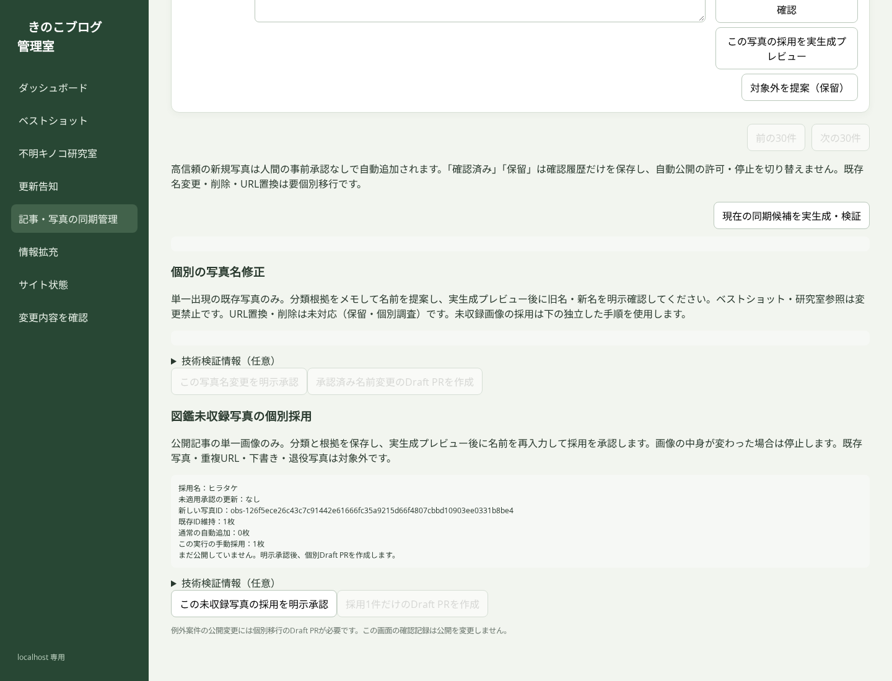

# Phase 2c：図鑑未収録画像の人間による個別採用

## 開始状態

- main: `5168da745d99f005fcd402f6317579bf9e062c23`
- tree: `b52e4d6aab3537314af5171c086826af3890579e`
- gh-pages: `e7abaee2efd4f8bedfefe2ade6993d2af301ea0a`
- 直近の日次Build & Deploy: `38218718081` SUCCESS。
- 906写真、Best Shot3件、研究室67件、退役7枚、名前移行0件。
- ブランチ: `phase2c-safe-manual-adoptions-2026-10-12`。

## 実装範囲

未収録の公開DOM画像を収録済み不明/研究室写真や従来の分類確認候補と区別し、画像・記事・検出根拠・公開日・撮影日（ある場合）を表示。人間は名前判明、種名不明、キノコ以外、保留を選択し、根拠と履歴を保存できます。

単一の許可CDN画像で、raw galleryにも既存公開galleryにも存在せず、公開記事のDOMと画像本体を独立検証できる場合だけ個別採用をプレビュー・明示承認・専用Draft PRに接続します。未登録名は推測で追加しません。通常の確認済み/保留/キノコ以外判断はローカル履歴で、同期の許可・停止条件ではありません。

## 安全性

- 元のAPI取得、DOM inventory、Phase3C cutover validator、通常ID照合、参照検証は変更せず、AST一致を確認（`unchanged-contracts.json`）。
- 元のPhase3Cを通過した後で独立projectionを追加。人間由来statusとhuman_reviewを別に持ち、元shadow/inventory/detected label/confidenceは保存したまま。
- 許可されたCDNへの認証なし・redirectなし・bounded GETでJPEG/PNG/WebPをverify。元画像SHA-256を承認/生成/最終ゲートで照合。
- 名称修正とは別のマニフェスト、ID namespace、台帳、API、1ファイルallow-listのDraft PR経路。
- 初回snapshot完全一致、以降は不変マニフェスト/適用台帳/同じ画像と元根拠を照合。毎日snapshotだけが更新された未適用承認は再レビューが必要。
- 手動行以外に元の自動追加ゲートを適用。手動採用を自動高信頼のreceiptに混ぜません。
- 名前変更機能のコード/allow-listは変更しません。実生成で同時適用と翌日継続を検証。
- 原子的fail-closed公開wrapperを維持。どの失敗でも旧サイトの内容は保持。
- admin/ローカル判断/本文/認証/マニフェストをPagesへ出力しません。

## 受入検証

- 実生成fixture：1枚、複数枚、名前判明、種名不明、新研究室ケース、自動追加との併用、翌日安定ID、旧参照保持、名称移行との併用。
- 未承認画像は自動で採用しない。元の高信頼新規写真は人間承認なしで追加。
- stale/不正名前/改ざん/重複/下書き/削除/URL変更/画像本体変更/原判定変更/manifest欠落/ledger破損を拒否。最終ゲート直前の画像変更も拒否。
- GET transportの許可host、redirect拒否、ambient認証除去、画像decode検証、CSRF・foreign origin・任意URL/path拒否をテスト。
- Chromium 1440：thumbnail表示、未収録フィルター、分類保存、実生成プレビュー、採用名再入力、監査保存、判断取消、既存タブ。console error/横overflowなし。写真とAPIはfixture。実写真を採用していません（`browser-validation.json`）。
- 管理画面のPR書き込みは分離worktreeのunit transportで検証。ブラウザーでは実PR書き込みを実行していません。

ローカル全pytest 812 passed / 812 collected、全JavaScript 43 passed、focused 106 passed。compileall・JS syntax・diff-check・Workflow YAMLも成功（`test-validation.json`）。実API GET-only検証は [Actions 38224423795](https://github.com/charchan123/hatena-photo-gallery/actions/runs/38224423795) でSUCCESS。12ページ/112entry/下書き2除外/公開110記事/976画像/906gallery。全906のID・名・URL・記事対応、Best Shot3件・研究室67件、退役7枚の出力検査PASS。322HTML、2回目SUCCESS・差分0。未収録70画像はすべて以前からの画像（新規0）。70は構造上の単一URL候補であり、キノコ判定や画像本体検証が済んだ採用件数ではありません。実写真の採用は未実施。一時workflowは最終差分から削除。最終の生成クラス/transportと検証commitとのAST一致を別途保存（`live-proof-continuity.json`）。最終head CIのActions URLと結果はPR本文/Checksで追跡し、最終応答前に確認します。

## 未対応・運用上の制限

- 重複URL、raw galleryに既に採用された画像、下書き/退役記事、取得不能/非対応形式・大きさ、対応が曖昧な画像は保留。
- URL置換、既存写真削除、退役復活、既存研究室履歴変更は対象外。
- 適用済み採用の取消・再分類・自動判定への移管は後続の個別移行。元根拠が変わった場合に勝手に切り替えません。
- 外部画像の永久不変は保証しません。生成時に本体を再検証し、変更が検出されれば旧公開状態を保持します。
- CIのEXIF cache restoreのみ追加して実API検証を効率化。画像内容ハッシュには利用しないため採用ゲートは独立したまま。generate workflowの日次/push/manual triggerは変更しません。
- この開発PRには実画像の採用manifestを含めません。マージしただけで906写真のID/名前/URLが変わることはありません。

使用手順：`docs/ARTICLE_PHOTO_SYNC_MANUAL_ADOPTION.md`。

## PR検証の本文隔離

追加監査で、旧名修正PRの実API検証はfresh worktreeの `articles/article_N.html` へ本文を取得するため、単一manifestのallow-listに新しい記事ファイルが抵触し得ることをコードで確認しました。採用PRでも同じ問題を引き継がないよう、固定Python validation codeをfresh worktreeから実行し、既存 `isolated_generator()` に本文・キャッシュを閉じ込めます。候補/レポートも外側の一時領域に限定。名修正経路にはこの呼び出しのみの最小修正を適用し、allow-listや承認条件は変更しません。固定コード自体を実生成fixtureで実行して、本文が元の作業領域へ書き出されないことを検証します。

## 古い未適用承認の再確認

初回公開前にsnapshotが更新された承認は失効します。未適用であることをsnapshot台帳と公開IDで証明でき、同一記事/URL/出現番号/新写真IDで再レビューした場合だけ、旧承認を新承認へ置換できます。previewは元ファイルを編集しません。専用PRは旧manifest削除＋新manifest追加の2パスだけを許可し、Git履歴に旧承認を保持。適用済みの承認を削除/置換することは禁止。これは写真削除の許可リストではありません。

## 最終CIで見つかった状態キャッシュの修正

最終候補 `06d3abc5...` のCI `38228085602` は1失敗/811成功。既存のActions状態cacheは、monotonic clockが小さい環境で空のvalueをcache hitとして返し得ました。空cache・失効marker・時計の後退をhitにしない条件へ修正。元のsanitize regressionにclock=0の再現を追加しました。生成/採用/写真IDゲートは変更せず、新しい最終head CIで全テストを再検証します。ローカル実行環境が応答しなくなったため、この3ファイルの修正をGitHubの保存済みブランチから復元しました。
