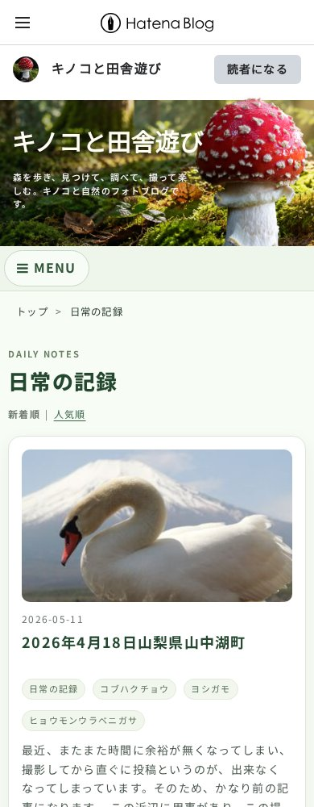
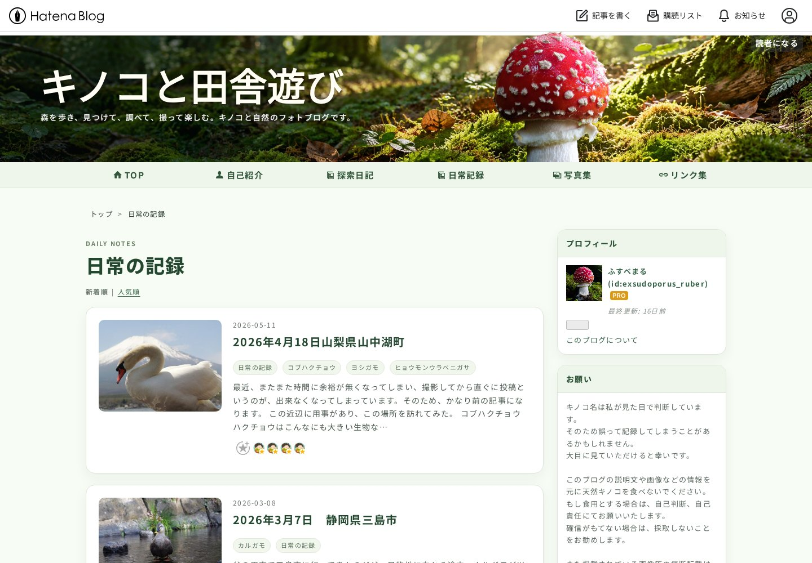

# 「日常の記録」カテゴリ一覧 Design CSS候補

Status: PASS（ローカルChromium検証）。Hatena本番・Preview・Stagingには保存していません。

## 基準と変更範囲

- Starting main: `81e0a39a32eda223cb3a9304f58d20b77e1be738`（PR #100マージ後）
- Starting tree: `463b89237923f74b975f5aa95c6661e44b158db8`
- Branch: `design-hatena-daily-archive-2026-10-11`
- 基準: `hatena/hatena-design-css-mobile-optimized-2026-10-09.css`
- 完全版候補: `hatena/hatena-design-css-daily-archive-2026-10-11.css`
- Scope: **DAILY CATEGORY ONLY**

候補は基準CSSの35,442 bytesを一切書き換えず、その後ろにカテゴリ専用ルールだけを追加しています。全71追加ルールは `body.page-archive-category.category-日常の記録` を根に持ちます。個別記事に同じカテゴリが付いても、`page-archive-category` がないため対象になりません。他カテゴリや通常archiveをまとめて変更するルールはありません。URL判定JSも追加していません。

## 公開DOMを確認して確定した構造

対象: <https://exsudoporus-ruber.hatenablog.jp/archive/category/%E6%97%A5%E5%B8%B8%E3%81%AE%E8%A8%98%E9%8C%B2>

HTTP取得した公開HTMLを、元のURL・テーマ・画像・スクリプトを使ってChromiumで描画して確認しました。HTML自体や親footerを修正する再現環境ではありません。取得URL・日時・HTML SHA-256は `daily-archive-review-2026-10-11/browser-validation.json` に保存しています。

実body class:

```text
page-archive enable-top-editarea enable-bottom-editarea page-archive-category category-日常の記録 globalheader-ng-enabled
```

| 役割 | 実DOM |
| --- | --- |
| 外枠 | `#container > #container-inner` |
| メイン＋サイドバー | `#content > #content-inner` の子に `#wrapper` と `#box2` |
| メイン | `#wrapper > #main > #main-inner` |
| カテゴリ見出し | `.archive-header-category > .archive-heading` |
| 並べ替え | `.archive-entries-sort`、新着順／人気順の既存リンク |
| 一覧／記事 | `.archive-entries > section.archive-entry`（8記事） |
| 日付／タイトル | `.archive-entry-header` 内の `.archive-date`、`.entry-title-link` |
| カテゴリ | 記事直下の `.categories > .archive-category-link` |
| 写真 | `.entry-thumb-link > .entry-thumb`、元のbackground-imageを保持 |
| 概要／タグ | `.archive-entry-body > .entry-description`、`.archive-entry-tags` |
| ネイティブ部品 | 8 Star container、8 bookmark linkを保持 |
| サイドバー | `#box2 > #box2-inner`、9 `.hatena-module` |
| Hero | `.header1`／`.header2` と既存 `img`。480pxで表示を切り替える元HTML内CSSを維持 |
| MENU／PAGE TOP | `#menu-btn`／`#menu-content`、`#page_top a`、公開HTMLの既存スクリプト |
| ページ送り | 現在の対象一覧には存在しない（全8記事）。未確認のmarkupやリンクを生成していない |

## デザイン

- 白・淡い緑の背景、濃い緑のタイトル、16pxの角丸と控えめな影。
- 既存Hero markupで採用済みのforest backgroundとAmanita cutoutを表示。記事と同じ232px／スマホ188px、上端7px白帯、スマホのbrightness(1.08)を使用。
- 見出しの元文字列「日常の記録」は維持。装飾として小さな `DAILY NOTES` を追加。補助文や新しい「続きを読む」リンクは生成していない。
- PCはmain＋300px sidebar。記事はthumbnail＋date/title/category/excerptの横並び。カードのgrid行を明示し、余分な空行を作らない。
- 960px以下はmain＋sidebarを縦積みにし、写真を記事の上へ。680px以下はpaddingとタイトルサイズをスマホ向けに調整。
- `:has(.entry-thumb-link)` はPCの画像付きカードだけに使用。画像なし記事は最初から全幅1列。`:has()`非対応環境でも全幅1列カードへフォールバックし、空の画像列を作らない。
- 日付・カテゴリを弱め、概要は14px／line-height 1.7。概要本文・長さ・リンク先は変えていない。
- サイドバーは白カード＋淡緑の見出し。全9 module・検索フォーム・カテゴリリンク・月別アーカイブ等を維持。
- MENUの色を既存記事に揃える。960px以下は、既存 `slideToggle()` が `display:block` にした際に浮動リンクを枠の高さへ含めるclearfixをカテゴリscopeで追加。JSの変更はない。
- PAGE TOPは既存挙動のまま、カテゴリ内でz-indexだけを記事と合わせる。

## 検証方法と結果

実公開DOMの既存Design CSS stylesheet位置へ候補を差し替えて比較しました。analyticsはブロックし、外部資材は取得済みcacheを再利用しました。Hatena管理画面の操作、Preview/Stagingへの保存、アカウント操作は行っていません。

Chromium 153によるレスポンシブ確認であり、Android実機の最終Staging確認はユーザーの手動適用後に行う前提です。

| 幅 | 横overflow | 一覧／sidebar | MENU | PAGE TOP |
| --- | --- | --- | --- | --- |
| 360 | NONE（360 ≤ 360） | 1列、sidebar下 | 開閉PASS | 700 → 0 PASS |
| 390 | NONE（390 ≤ 390） | 1列、sidebar下 | 開閉PASS | 700 → 0 PASS |
| 430 | NONE（430 ≤ 430） | 1列、sidebar下 | 開閉PASS | 700 → 0 PASS |
| 768 | NONE（768 ≤ 768） | 1列、sidebar下 | 開閉PASS | 700 → 0 PASS |
| 960 | NONE（960 ≤ 960） | 1列、sidebar下 | 開閉PASS | 700 → 0 PASS |
| 961 | NONE（961 ≤ 961） | main＋sidebar、横並びカード | PCリンク表示 | 700 → 0 PASS |
| 1440 | NONE（1440 ≤ 1440） | main＋sidebar、横並びカード | PCリンク表示 | 700 → 0 PASS |

全幅で8記事・8 Star container・8 bookmark link・9 sidebar moduleを保持。実DOMのタイトル／カテゴリ／sidebar／MENUリンクhrefと文言を維持し、タイトルのhit testと検索フォームの入力有効性も確認しました。Star購入・ログイン・bookmark送信等の外部サービス操作は実行していません。

画像なし記事はブラウザ内だけで最初のthumbnail要素を一時除去して確認。本文が全幅を使い、空の画像列ができません。長い日本語＋空白なし英字のタイトルを一時設定した場合も全幅でoverflowなしでした。これらのfixture変更は候補CSSや公開HTMLに含まれません。

ページ送り: **N/A（実対象DOMに存在しない）**。現在の新着順／人気順リンクは保持し、装飾しています。将来ページ送りが発生した場合は、その実DOMを確認して追加レビューしてください。

### 回帰比較

同じ公開ページDOMで、基準CSSのstylesheetと完全版候補を入れ替え、import先テーマのload完了を待って比較しました。途中のimport読み込み状態を比較に混ぜていません。

| ページ | 幅 | 要素・疑似要素computed style記録 | 差分 |
| --- | --- | --- | --- |
| new-top | 390 | 51 | 0 |
| new-top | 1440 | 51 | 0 |
| 個別記事 | 390 | 150 | 0 |
| 個別記事 | 1440 | 150 | 0 |

Hero、Amanita、MENU、content、entry title/body/photo、存在するcomment/social/Star領域、sidebar、PAGE TOP、new-top iframe等について、display/position/size/margin/padding/overflow/background/font/color/border/shadow/transform/clip-path/filter/z-index/pointer-eventsを比較。追加scopeの一致数はいずれも0。新トップ・個別記事の基準CSSと画像assetは変更していません。

### CSSと差分検証

- tinycss2: 完全版および追加sectionのrule/declaration parse error 0。
- Chromium: 追加71ルールのselector branchはすべて有効。追加declarationの `CSS.supports(property,value)` エラー0。`:has()`対応も確認。
- 基準CSS: SHA-256と完全版先頭のbytesを照合し一致。
- `git diff --check`／`git diff --cached --check`: PASS。元system sectionのCRLF 8行をbyte単位で保持するため、Gitのローカル `core.whitespace=cr-at-eol` で正しく判定。空白を削除したり、元sectionを書き換えたりしていません。
- Protected paths／既存JS／既存Hatena CSS／footer／GitHub Pages UI: 開始mainからの差分なし。
- Python／JSコードやtestsは変更していないため、全pytest・generator buildの無関係な再実行は省略。上記CSS・ブラウザ・機能のfocused validationを実施。

## 完全版のサイズ

- Lines: **1,718**
- UTF-8 bytes: **49,662**
- SHA-256: `f242421591f50379ffbd8cd24c3745610f256d2ef9b42a61def48d08d08ba013`
- 基準CSS SHA-256: `4298621f4f6f85c11ac0f7496b452e5774e2664501f416af23069d0e1b907842`

[Hatena公式ヘルプ](https://help.hatenablog.com/entry/design/design-css)の64KiB上限に対し、UTF-8 bytesで**15,874 bytes（約24.2%）の余裕**があります。

## レビュー用成果物

- 完全版CSS（このファイルをDesign CSS全置換候補として利用）
- 本レポート
- `daily-archive-review-2026-10-11/browser-validation.json`（DOM同一性、各幅、native controls、画像なし、回帰比較）
- `daily-archive-review-2026-10-11/css-validation.json`（hash、parser、selector/declaration検証）
- `daily-archive-review-2026-10-11/daily-390.jpg`
- `daily-archive-review-2026-10-11/daily-1440.jpg`





## 手動適用と戻し方

1. 現在のHatena Design CSSをバックアップ。
2. 完全版候補を全文置換してStaging確認。
3. 日常の記録一覧と、new-top／通常記事／他カテゴリが想定どおりか実機で確認。
4. ユーザーの判断で本番公開。戻す場合は現在の採用済みmobile-optimized baseline全文を再適用。

今回Hatena本番・Preview・Stagingは変更していません。footer、iframe protocol、biology、provenance、毒性、facets、GitHub Pages側のUIも未変更。mainへのpush、merge、deploy、auto-merge、workflow_dispatchは行いません。Draft PR作成で停止します。
